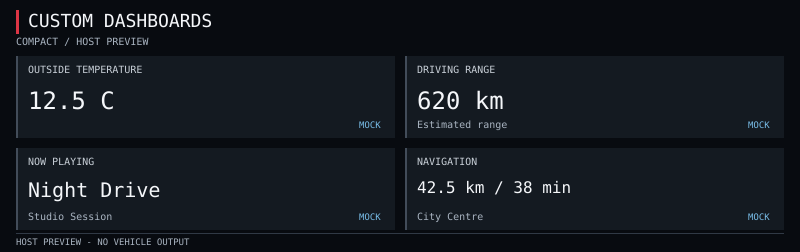
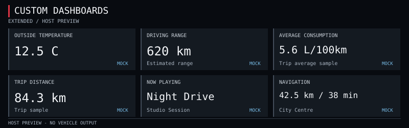

# Host dashboard previews

All displayed values are MOCK. These are standalone SVG artifacts, not vehicle
screenshots or verified Virtual Cockpit layouts. No safe in-car dashboard area
has been established. Final visual/readability testing is deferred by the user.

| Layout | 800x252 | 640x360 |
| --- | --- | --- |
| Compact | [Wide](compact-wide.svg) | [Tall](compact-tall.svg) |
| Extended | [Wide](extended-wide.svg) | [Tall](extended-tall.svg) |

Generation command from the repository root: `make -C dashboard previews`.
The saved artifacts were generated before the user's testing-deferral instruction.
The final testing stage (P2-04) re-checks them against CLI output.
See [rendering.md](../../docs/custom-dashboards/rendering.md) for the API, design
limits and commands, and [changes.md](../../docs/custom-dashboards/changes.md)
for the per-file change record. No screenshot or font-fit claim is made.
