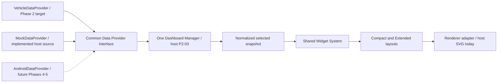

# Audi MIB2Q — five-phase project roadmap

This is the persistent product context for Codex, Claude and other agents. Read
it with [AGENTS.md](../AGENTS.md) and the current
[agent checkpoint](custom-dashboards/audit/CURRENT.md) before continuing work.
The roadmap describes future goals; it is not permission to implement every
phase, run tests or contact the vehicle.

## Goal and environment

Extend an Audi A4 B9 (2017), 2.0 TDI quattro 190 HP, MMI High without touchscreen,
Virtual Cockpit and physical MMI rotary controller/buttons. The project is a
fork of [kamgurgul/mib2q-carplay](https://github.com/kamgurgul/mib2q-carplay),
investigated at `b127988a68c8d690841f4a75d35717ffc01e668e`.

The future Android application targets the user's **Samsung Galaxy S23 Ultra**.
It will initially operate independently, later communicate with MMI, then supply
additional data to existing dashboard widgets. Android Auto uses the **original
AAWireless adapter, not AAWireless TWO+**; this does not establish a general
application-to-MMI transport.

Exact MHI2Q firmware, hardware/receiver compatibility, safe dashboard surface and
successful Phase 1 installation have not been independently confirmed. Existing
reports for another car, firmware or adapter do not resolve these unknowns.

## Phase summary

| Roadmap phase | Deliverable | Current state |
| --- | --- | --- |
| 1 — Upstream baseline | Install and establish the upstream project as-is through a separately authorized process. | Vehicle installation/success unconfirmed; local source investigation complete. |
| 2 — Custom dashboards: Real Vehicle Data Integration | Working Compact/Extended dashboards in the Virtual Cockpit showing real data from existing MMI systems; mock only for tests ([scope](custom-dashboards/requirements.md#phase-2-scope--real-vehicle-data-integration-authoritative)). | CURRENT PHASE, **not complete**. Mock-only host foundation done and tested (P2-01..P2-05). Real data binding, VC rendering and in-car validation outstanding; head-unit work awaits user decision. |
| 3 — Independent Android app | Standalone app on Galaxy S23 Ultra, usable without MMI. | Future; not implemented. |
| 4 — Android/MMI communication | Establish a separately validated data connection; introduce AndroidDataProvider as its normalized adapter. | Future; transport unknown and unimplemented. |
| 5 — Android data in dashboards | Feed AndroidDataProvider into the same manager/widgets alongside VehicleDataProvider. | Future; depends on validated transport/data and safe display integration. |

**Numbering matters:** `P2-01` through `P2-06` are development subtasks within
roadmap Phase 2, described in [the Phase 2 plan](custom-dashboards/PLAN.md).
`P2-03` means dashboard configuration/suppression. **Roadmap Phase 3 means the
standalone Android application.** Never substitute one for the other.

## Phase 1 — install upstream as-is

Establish whether the exact unit/firmware, cluster and projection setup support
upstream behavior. Record the upstream revision, compatibility evidence, existing
OEM navigation behavior and rollback basis without introducing custom dashboards.
Do not infer successful installation from the repository being present locally.

Exit evidence, when separately authorized: confirmed firmware/hardware, recorded
baseline behavior and documented recovery. No flashing, installation, stock-file
modification or head-unit execution is authorized in the current work session.
Missing Phase 1 confirmation does not prevent independent host-only Phase 2 work;
it does block claims that the vehicle integration is ready.

## Phase 2 — Real Vehicle Data Integration (current)

**Scope (authoritative):** build fully functional custom dashboards displaying
real data from the vehicle's existing MMI systems, with Compact and Extended
layouts, inside the Virtual Cockpit. Mock data only for automated tests and
development; a dashboard showing simulated data is not a Phase 2 deliverable;
unavailable signals are documented and their widgets omitted; no dependency on
the future Android app. Full text, gap table and open decisions:
[requirements.md](custom-dashboards/requirements.md#phase-2-scope--real-vehicle-data-integration-authoritative).

The host foundation below (P2-01..P2-05) is a prerequisite, not the deliverable:

- A common Data Provider Interface returns normalized owned snapshots.
- **VehicleDataProvider** is the Phase 2 adapter role for demonstrated read-only
  vehicle/existing-system sources. Wire real fields only after their units,
  meaning, validity, freshness and session availability are verified. It is
  currently a design target, not an implemented live adapter.
- **MockDataProvider** supplies explicit development examples; it is the only
  implemented provider and must not masquerade as live vehicle data.
- One Dashboard Manager consumes the common contract. Layouts/widgets see
  semantic values, provenance and validity, not provider-specific transport.
- Compact and Extended layouts reuse the same Widget System and renderer adapter.
- Disabled-by-default configuration, suppression, source selection and rollback
  preserve the OEM experience. A host single-provider manager and strict config
  exist since P2-03 (compiled, tests deferred); source selection is outstanding.

**Implemented in code:** the generic `db_provider` callback/context, typed
`db_snapshot`, mock source, widget formatters, two host layouts and SVG export;
see [dashboard.h](../dashboard/dashboard.h),
[module guide](custom-dashboards/module.md) and
[rendering guide](custom-dashboards/rendering.md).

**Not established:** a safe non-critical VC rectangle, real VehicleDataProvider,
AndroidDataProvider, provider resolver, live MMI data subscriptions or manager
activation. Existing guidance/map displayables cannot be assumed available for
dashboard use. Retain the host fallback if safety cannot be demonstrated.

Exit target: a working dashboard in the Virtual Cockpit showing verified real
vehicle data, validated on this car. The host foundation (contracts, tests,
package) is done; host results never authorize vehicle testing by themselves.

## Phase 3 — standalone Android application

Develop an application for the Galaxy S23 Ultra that starts, collects permitted
data and presents useful information **independently of MMI connectivity**.
An absent MMI, upstream install or wireless adapter must not prevent its initial
standalone operation. Actual available phone/app signals and permissions must
be investigated rather than assumed.

Keep its domain data model separable from later communication. Document semantic
signal IDs, units, validity and data age aligned with the Phase 2 provider model.
Sharing concepts does not require a shared binary ABI or identical Java/C structs.

Phase 3 does not implement MMI transport, an MMI provider, custom Android Auto
projection behavior or dashboard integration. Exit target: independently usable
phone application, documented data capabilities and standalone lifecycle behavior.
No Android application work is implemented or authorized by this roadmap update.

## Phase 4 — establish communication with MMI

Investigate and choose a feasible, explicitly authorized connection between the
standalone application and an MMI-side data consumer. Transport, protocol,
discovery and hardware support remain **unknown**. Do not assume Android Auto,
AAWireless, Bluetooth, USB or Wi-Fi exposes a suitable channel. Do not add an
invasive hook to force connectivity.

Design a bounded, versioned data protocol with capability negotiation, units,
source/session identity, freshness, malformed-message handling and disconnect
behavior. Define the applicable trust/access rules for the chosen transport.
Validate with host endpoints first when separately requested; vehicle actions
require their own authorization and compatibility evidence.

Introduce **AndroidDataProvider** as the adapter from validated received data
into the existing normalized snapshot contract. Keep connection I/O and parsing
away from the render path; the provider reads a bounded local cache. This phase
proves communication/data normalization, not dashboard activation.

Exit targets: demonstrated connection under the chosen platform constraints,
recorded reconnect/disconnect and invalid-input behavior, and an adapter contract.
No Android communication, listener, transport stub or app is implemented now.

## Phase 5 — Android data in existing dashboards

Use AndroidDataProvider through the same Dashboard Manager and Widget System
used by VehicleDataProvider. Additional data enriches existing widgets where its
meaning matches the semantic contract; adding a genuinely new signal/widget is
an ordinary extension, not a second dashboard implementation.

The manager uses explicit per-signal selection; there is no implicit last-writer
wins. Preserve source identity and validity. Android loss must invalidate its
cached values without stopping independently available vehicle fields. Never
replace an unavailable live reading with unlabeled mock values. Incompatible
units, stale data or unknown semantics remain unavailable.

Exit targets: documented provider selection/fallback, unchanged shared layout/
widget behavior for existing signals, safe disconnect handling and separately
verified display ownership. Phone communication success does not establish safe
vehicle rendering or permission to cover OEM instrumentation/navigation.

## Shared architecture and evolution rules

This is the target wiring, not a claim that all boxes are implemented. The
[Data Provider design](custom-dashboards/data-providers.md) maps it to the actual
C API and specifies future metadata, selection, clock and lifecycle extensions.
Keep that document and [architecture.md](custom-dashboards/architecture.md)
aligned before implementing an adapter or manager.

Source selection belongs to the manager/a small composite provider wrapper;
widgets do not perform network calls, DSI subscriptions or provider selection.
Keep interfaces transport independent. Do not introduce a new framework or
transport dependency in Phase 2 merely because later phases need communication.

## Persistent safety and session rules

Preserve OEM operation, navigation, speed/warnings and all critical vehicle
functions. Never alter control, braking, steering, ADAS or warning logic. No
safety-critical control interception, destructive stock-file edits, unproven
hooks or DPF monitoring. Dashboard functionality stays disabled by default.

Roadmap goals do not grant deployment permission. Current work remains host-only;
no head-unit commands, flashing, installation or vehicle deployment. Host tests run in
P2-04, the final testing stage. Document every change, update the
audit before handoffs, and use the latest explicit user task to select work.
