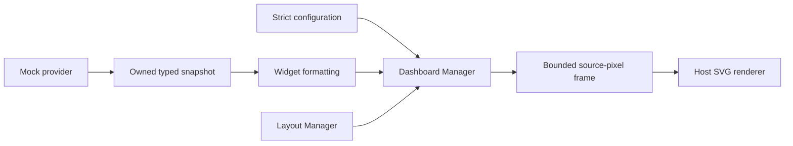

# Dashboard architecture

Status: P2-01 data/widgets and P2-02 Compact/Extended layouts/SVG export are
implemented. See [module.md](module.md) and [rendering.md](rendering.md).
Configuration/activation manager remains future work; no vehicle backend exists.
The user has deferred further testing until the final stage. Earlier test results
are historical evidence, not final graphics acceptance.

## Decision

Build a standalone C99 host prototype first. Upstream has demonstrated graphics
surfaces for maneuver guidance (98) and map video (99), but has not established a
spare, non-critical dashboard area for this A4. Reusing either surface now could
cover navigation. The detailed [investigation](analysis.md) records
the source evidence and its limits.

The project inherits upstream's full source and history. No changes are made to
the inherited Java classes, hooks, display contexts, deploy scripts, firmware or
input handling. The exact firmware,
original AAWireless compatibility and successful Phase 1 installation remain
unknown. Compilation cannot resolve those unknowns.

## Planned project organization

```text
PROJECT.md                         custom dashboard project entry point
README.md                          original upstream README, unchanged
docs/custom-dashboards/             architecture, investigation, plan, requirements
maneuver_render/ altscreen_render/  inherited renderers, unchanged
common/ aa_hook/ java_patch/        inherited common code/hooks/HMI patch, unchanged
deploy/ mods/ scripts/ tests/       inherited tooling and tests, unchanged
dashboard/                         IMPLEMENTED data/widgets, layouts, SVG, CLIs and previews
tests/dashboard_test.c             IMPLEMENTED host contract and formatter tests
build/                             existing ignored host build output
```

## Components and contracts



The planned **Dashboard Manager** prepares a complete frame on explicit request. It checks
enablement, configuration, viewport and provider success, and clears all previous
commands on suppression. There is no background loop, animation or polling thread.

The implemented **Data Provider Interface** is a callback returning an owned snapshot. Each
field includes availability, provenance, canonical units and monotonic sample time.
Only a deterministic mock provider ships in P2-01. Missing or invalid data must never become
zero; stale samples lose their displayed values. Future validated read-only
providers can fill this contract without changing layouts or widgets. This is an
interface boundary, not implementation of roadmap Phases 3–5.

The implemented **Widget System** formats temperature, range, media, final-destination
distance/duration, trip distance and average consumption. All initial values are
explicitly labeled MOCK. No speed, warning, braking, steering or ADAS widget is
planned. ETA must not be derived from an unverified clock.

The implemented host **Layout Builder** creates Compact (2x2) and Extended (3x2) dark layouts with
bounded labels, high contrast and minimal decoration. Host preview dimensions
are experiments, not certified VC configurations. The initial prototype will
reject the known 210x153 and 328x180 maneuver crops as a deliberate design limit;
readability and fit still need host testing. No dashboard crop is guessed.

The planned **Configuration Manager** accepts a small, strict, versioned text format:
`version=1`, `enabled=0|1`, `layout=compact|extended`. Missing/invalid configuration
means disabled Compact. Layout selection alone never enables output. Restore
default uses the same disabled configuration. Paths are supplied explicitly;
there are no vehicle marker paths or automatic file writes.

The implemented host **Renderer Adapter** exports clipped, escaped SVG from fixed rectangle/text
commands. It reuses the upstream source-pixel rectangle type through its header,
without linking the GL renderer or creating a QNX window. SVG text uses host
fonts; production Unicode shaping and a GLES text adapter are deferred. The
header rejects QNX compilation until a vehicle backend
has passed a separate feasibility gate.

## Future integration gate

A vehicle adapter is **blocked**, not part of the current implementation. It
requires exact firmware and ABI evidence, Phase 1 confirmation, a proven
non-critical rectangle and ownership rules that always yield to OEM navigation
and instrumentation. A spare displayable number does not satisfy that gate.

Green Engineering Menu generation supports script buttons upstream. A future
Custom Dashboards page could offer Enable, Disable, Compact, Extended and Restore
Default, but no controls are added until a safe consumer exists. Physical vehicle
controls are not intercepted.

## Validation and rollback

Planned host tests cover configuration, units, age, provenance, layout bounds, SVG
escaping/clipping, provider failure, clearing and preparation cost. Run upstream
regression scripts separately and report missing proprietary assets/toolchains.

The planned host prototype will support disabled/default configuration. For
P2-01, `make -C dashboard clean` removes generated outputs; no runtime integration
exists to disable. Source work can be reverted by its feature commit. No car
files need restoration because none are changed.
