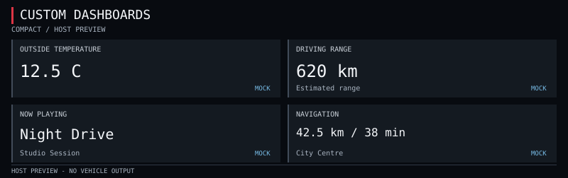

# P2-02: host layouts and SVG export

Compact and Extended frames are now implemented on top of the P2-01 snapshot,
widget formatter and fixed draw-list contracts. They export host SVG artifacts
only. There is no QNX window, vehicle display routing, live provider, configuration
manager, GEM action or automatic rendering loop.

**Testing policy:** tests were deferred during P2-02 until the final stage;
P2-04 has started that stage and runs them. Earlier results are recorded separately in
the audit/status; final validation and visual inspection are outstanding.

## Previews

These SVGs were generated before the test-deferral instruction. They use mock
values and host fonts; their dimensions are not verified Virtual Cockpit layouts.
No successful browser screenshot or visual inspection has been established.

| Layout | Wide 800x252 | Tall 640x360 |
| --- | --- | --- |
| Compact | [SVG](../../dashboard/previews/compact-wide.svg) | [SVG](../../dashboard/previews/compact-tall.svg) |
| Extended | removed in P2-07; regenerate at the final testing stage | removed |



The Compact grid is 2x2: temperature, range, media and navigation. Extended is
3x2 (since P2-07): temperature, range, now playing, distance to destination,
time to destination and destination ([widgets-p2-07.md](widgets-p2-07.md)). Dark backgrounds,
white primary text, muted labels, a restrained red heading accent and blue MOCK
badges provide a stable theme. Unavailable/stale/invalid fields use placeholders
and amber state badges. No safety instrumentation is represented or replaced.

## API

See [dashboard.h](../../dashboard/dashboard.h) for signatures.

- `db_layout_build`: takes a layout, owned snapshot, sample clock, canvas dimensions
  and explicit source-pixel rectangle. Fills a complete `db_frame`, returning 1;
  invalid inputs clear the entire old output and return 0. Null output is a no-op.
  The output must not alias the input snapshot. It calls the existing formatter,
  so missing/stale values cannot retain old text.
- `db_frame_valid`: checks the whole draw list: dimensions, finite integer
  geometry, clip containment, command count, kinds, RGB and bounded ASCII text.
  It validates a host frame, not a safe vehicle surface. Empty draw lists with
  valid canvas/clip metadata are accepted for later suppression support.
- `db_frame_write_svg`: validates before emitting the first byte, then writes
  a standalone SVG. XML special characters are escaped. Every text box has its
  own clip; the entire frame is clipped to the supplied viewport. Caller owns
  the stream and must handle buffered flush/close errors. Output coordinates
  are integers and do not depend on floating-point locale formatting.

The builder accepts integer viewports at least 640x240 inside a canvas no larger
than 4096x2160. Offset viewports are supported. Negative coordinates, fractions,
NaN/infinity, out-of-canvas bounds, unknown layouts and missing snapshots fail
closed. Known 210x153 and 328x180 maneuver crops are intentionally rejected.
There is no guessed crop or automatic fallback into a guidance area.

The fixed 48-command buffer is reused. Layouts prepare geometry on explicit
request, without heap allocation, threads or animations. No head-unit CPU/FPS
claim follows from these design choices; performance measurement remains later work.

## Text and theme contract

The renderer selects `DejaVu Sans Mono,monospace`; no font file is bundled. Text
is elided with `...` using a conservative character advance estimate, then clipped
again by SVG. It does not measure glyphs or implement Unicode shaping. Actual
font fallback/readability must be reviewed at the final visual validation stage.
Typical mock values retain their units in the four generated profiles; unusually
long values or names can be elided and are visibly marked with dots.

Labels use 10px text, primary values 20–24px except navigation (14–16px to fit the
duration), detail text 10px and badges 9px. These are host design sizes, not an
assertion of in-car legibility. Each card carries the formatter's current badge;
the overall banner says `HOST PREVIEW - NO VEHICLE OUTPUT`.

## Explicit preview command

The new CLI exports to stdout only when both layout and profile are specified:

```sh
make -C dashboard all
build/dashboard/dashboard_preview compact wide > compact.svg
build/dashboard/dashboard_preview extended tall > extended.svg
make -C dashboard previews
```

These are reproduction commands for later use, not a request to run tests now.
The preview CLI uses the existing mock provider and a deterministic clock. Missing
or invalid arguments print usage to stderr with exit 2 and no SVG output. There
is no startup/config file, persisted enable state, socket or vehicle marker.

`make -C dashboard previews` writes the four reviewable SVG files under
`dashboard/previews/` (only the two Compact files are committed since P2-07). Other build products stay under ignored `build/dashboard/`.
Clean removes executable/library/test outputs; it preserves the saved SVGs.

## Tests prepared for the final stage

The C rendering suite covers layout contents and source-pixel bounds, offset and
minimum viewports, rejecting guidance crops/nonfinite geometry, clearing old
frames, placeholders/elision, malformed commands, XML escaping and observed I/O
errors. The independent Python suite parses SVG as XML, checks all four profiles,
mock badges, clip references, deterministic bytes, CLI errors and escaped-text
round trips. When saved previews exist it also checks that they match CLI output.

Commands (run in P2-04; historical). Tests are deferred: the user said "do not run any test, there will be a ask at the end to implement and run the tests". The suites are out of date since P2-07/P2-08; run them only at that final request.

```sh
make -C dashboard previews
make -C dashboard test
make -C dashboard test-sanitize
```

Python uses only its standard library. The sanitizer target runs both widget and
rendering C suites. Existing sandbox/Java/toolchain limitations are documented in
[status.md](status.md). Do not equate earlier checks with final acceptance.

## Rollback and next scope

Stop using the host preview command and run `make -C dashboard clean` when desired.
No head-unit files need restoration. Source changes can be reverted by their
feature commit while preserving unrelated edits. The module remains excluded
from inherited install/build/release payloads.

Step 3 will add explicit disabled-by-default configuration and the manager's
suppression policy. Current layout building is an explicit host preview operation,
not a dashboard activation path. Vehicle integration remains blocked. See the
[change ledger](changes.md) for every changed source/artifact and its purpose.
